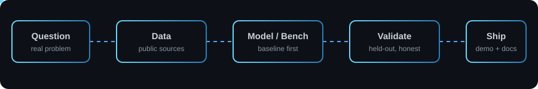
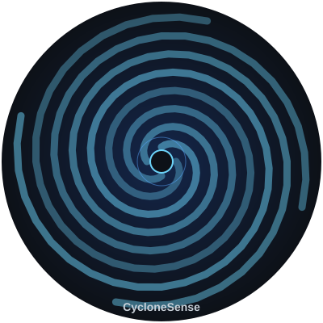

<div align="center">



<a href="https://github.com/priyadarshipiyush954-collab">
  
</a>

<br/><br/>

[](https://www.linkedin.com/in/piyush-priyadarshi-540452349)
[](https://www.instagram.com/piyush_priyadarshi04/)
[](mailto:priyadarshipiyush954@gmail.com)
[](https://github.com/priyadarshipiyush954-collab)

</div>

---

### 👋 About Me

```yaml
name: Piyush Priyadarshi
role: CS Undergraduate @ Manipal University Jaipur
focus: Applied AI & ML — climate, satellite imagery, computer vision
research: Smart-contract gas efficiency & security (ERC-721)
stack: [Python, PyTorch, TensorFlow, OpenCV, FastAPI, TypeScript, React, Solidity]
status: Open to AI/ML & Software Engineering internships
```

I like problems where a model has to be *checked*, not just trained: held-out storms, explicit baselines, benchmarks that can be reproduced. I'd rather ship a working prototype with honest numbers than a polished slide deck.

<div align="center">

</div>

---

### 🌪️ Spotlight — CycloneSense

<table>
<tr>
<td width="32%" align="center">

</td>
<td>

**[CycloneSense](https://github.com/priyadarshipiyush954-collab/CycloneSense)** · [Live dashboard](https://cyclone-sense-2klx.vercel.app/)

A live cyclone dashboard built on satellite imagery and storm-track feeds, with a research model for track forecasts and an uncertainty cone derived from validation error.

**Research snapshot:** the North Indian Ocean fine-tune uses 330 six-hourly windows across 20 storms, with five entire storms held out for validation. It beats the last-motion persistence baseline at 7 of 8 forecast leads, but has higher error at +6 h. This is a small research evaluation, **not an operational forecast**. [Model notes](https://github.com/priyadarshipiyush954-collab/CycloneSense/blob/main/docs/MODEL.md)

**Next:** a larger public dataset on Kaggle, and a simple live satellite map of India for real-time cyclones.

   

</td>
</tr>
</table>

---

### 🔬 Research

<table>
<tr>
<td>

**⛓️ An Empirical Evaluation of Gas Efficiency and Selected Security Properties in Modular ERC-721 Smart Contracts**

Team study at Manipal University Jaipur (DSE2170 PBL-2) measuring the gas overhead of Solidity security mechanisms across five contract variants, benchmarked against ERC-721 and ERC-1155 reference implementations, with an analysis of the NFTY modular framework.

📄 Status: **manuscript in preparation** (IEEE format) · 💻 [Code & data](https://github.com/priyadarshipiyush954-collab/modular-nft-erc721)

  

</td>
</tr>
<tr>
<td>

**🌪️ Tropical cyclone track forecasting (North Indian Ocean)** — storm-level holdouts and an explicit persistence baseline; see the CycloneSense spotlight above.

</td>
</tr>
</table>

---

### 🚀 Featured Projects

<table>
<tr>
<td width="50%">

**🙂 [AURA Vision — Face-Recognition Attendance](https://github.com/priyadarshipiyush954-collab/Face-Recognition)**
FastAPI + OpenCV (YuNet) + scikit-learn attendance system with a web demo, currently being hardened for a controlled pilot: security, privacy, data integrity and valid evaluation.
  

</td>
<td width="50%">

**🏗️ [HACKHATHON3.0 — Drone Routing Engine](https://github.com/priyadarshipiyush954-collab/HACKHATHON3.0)**
Autonomous multi-agent drone routing with no-fly-zone avoidance, energy management and parallelism.
 

</td>
</tr>
<tr>
<td width="50%">

**📄 [Resume Analyzer](https://github.com/priyadarshipiyush954-collab/hackhathon)**
AI resume scanner that matches resumes against job descriptions, with a web frontend.
 

</td>
<td width="50%">

**🎙️ [ai_voice](https://github.com/priyadarshipiyush954-collab/ai_voice)**
Voice-based AI assistant with speech recognition.


</td>
</tr>
<tr>
<td width="50%">

**🖐️ [HandTrackingProject](https://github.com/priyadarshipiyush954-collab/HandTrackingProject)**
Real-time hand tracking application.
 

</td>
<td width="50%">

**🔍 [object-detection-2](https://github.com/priyadarshipiyush954-collab/object-detection-2)**
Object detection pipeline.


</td>
</tr>
</table>

#### 🧪 In progress

- 🌫️ **Air-quality downscaling** — AI/ML to turn coarse air-quality data into high-resolution AQI maps
- 🎓 **Career guidance platform** — personalised, AI-powered guidance for underserved students
- 🛒 **Agentic commerce** — a hackathon build for the *AI Growth & Agentic Commerce* track

---

### 📊 GitHub Stats & Analytics

<div align="center">


<br/><br/>

<a href="https://github.com/priyadarshipiyush954-collab">
  
</a>
<a href="https://github.com/priyadarshipiyush954-collab">
  
</a>

<br/>

<a href="https://github.com/priyadarshipiyush954-collab">
  
</a>

<br/>


</div>

---

### 🛠️ Tech Stack

<p align="center">

</p>

---

### 🐍 Contribution Activity

<p align="center">
  <picture>
    <source media="(prefers-color-scheme: dark)" srcset="https://raw.githubusercontent.com/priyadarshipiyush954-collab/priyadarshipiyush954-collab/output/github-contribution-grid-snake-dark.svg">
    <source media="(prefers-color-scheme: light)" srcset="https://raw.githubusercontent.com/priyadarshipiyush954-collab/priyadarshipiyush954-collab/output/github-contribution-grid-snake.svg">
    
  </picture>
</p>

---

### 🎯 Currently

- 🔭 Taking CycloneSense from a research prototype toward a public dataset and a live India satellite map
- 📝 Preparing the ERC-721 gas-efficiency study for publication
- 🛡️ Hardening AURA Vision for a controlled pilot
- 🌱 Sharpening competitive-programming and system-design skills for hackathons (Goldman Sachs India Hackathon 2026)
- 💬 Ask me about **CycloneSense, satellite-based AI, computer vision, or Python / PyTorch / FastAPI builds**

---

<div align="center">

</div>
